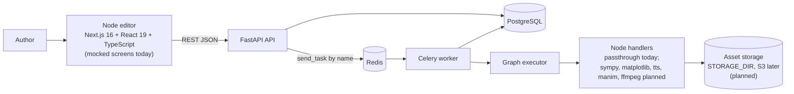
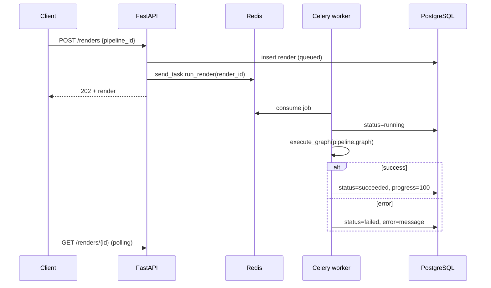
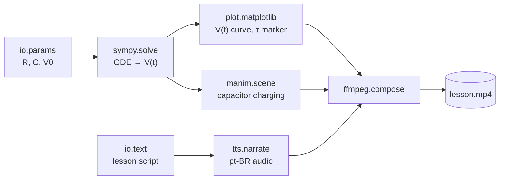

<div align="center">

# ∂ DerivaAI

**Node-graph pipelines that turn math and physics into narrated, animated lessons.**

Write the equation. Wire the nodes. Render the video.

[](#project-status)
[](https://github.com/acidbutter96/derivaai-backend)
[](https://github.com/acidbutter96/derivaai-backend)
[](https://github.com/acidbutter96/derivaai-frontend)
[](#technologies)
[](#technologies)
[](https://github.com/acidbutter96/derivaai/issues)
[](https://github.com/acidbutter96/derivaai/releases)
[](https://github.com/acidbutter96/derivaai/commits)

[Purpose](#purpose) · [Status](#project-status) · [Architecture](#architecture) · [Technologies](#technologies) · [Getting started](#getting-started) · [Roadmap](#roadmap) · [Issues](#issues) · [Releases](#releases) · [Docs](#documentation)

</div>

---

## Purpose

Explaining an engineering or physics concept as a good video is slow work: derive the math, plot it, animate it,
record narration, then cut it all together by hand. Change one parameter and you redo most of it.

DerivaAI treats a lesson as a **program**. An author builds a free-form pipeline in a ComfyUI-style visual node
editor: parameters flow into a symbolic solver, the solution feeds a plot and an animation, a script feeds a
text-to-speech node, and a final node composes everything into an MP4. Lessons come out in English and Brazilian
Portuguese (`en`, `pt-BR`).

- **Programmable**: a lesson is a graph of nodes, not a timeline of clips.
- **Reproducible by design**: [design v2](docs/design-v2.md) pins every render to an immutable pipeline version (proposal, not built yet).
- **Fast to iterate**: the same proposal re-runs only the nodes you changed and everything downstream, and reuses cached results for the rest.
- **Bilingual**: lessons carry a language (`pt-BR` or `en`).

The first acceptance target is a `pt-BR` lesson on **RC circuit charging**, `V(t) = V0 (1 - e^(-t/RC))`, delivered
as a narrated MP4. See [the RC lesson flow](docs/rc-lesson-flow.md).

## Project status

DerivaAI is an early **prototype**. This table is the honest picture of what runs today.

| Area | State |
|---|---|
| Backend API (5 domains, 24 endpoints including `/health`), Celery render queue, graph executor | **Implemented**, tested, validated against real Postgres and Redis |
| Node handlers | Only `passthrough` exists. `sympy.solve`, `plot.matplotlib`, `tts.narrate`, `manim.scene`, `ffmpeg.compose` are **planned** |
| Asset storage | Metadata only. Writing real files is **planned** (roadmap slice 3) |
| Frontend | **Mocked screens** (lessons, pipelines, editor, renders, node catalog) on top of `src/lib/mock`. Not wired to the API yet |
| Node editor canvas | Custom canvas with a client-side worker simulation. React Flow integration is **planned** |
| Auth, S3/CDN, other lesson topics | Out of the MVP |
| Tagged releases | None yet, see [Releases](#releases) |

## Architecture

DerivaAI is split across three repositories, tied together by this one using Git submodules.

| Repository | Role |
|---|---|
| [`derivaai`](https://github.com/acidbutter96/derivaai) (this repo) | Project hub: docs, design system, wireframes, submodule pointers |
| [`derivaai-backend`](https://github.com/acidbutter96/derivaai-backend) | FastAPI API, Celery worker, graph executor |
| [`derivaai-frontend`](https://github.com/acidbutter96/derivaai-frontend) | Next.js app: design system components and mocked screens |

### System context



### Render lifecycle

A render is one execution of a pipeline. The API never runs it inline: it stores a `queued` render, enqueues the
job by task name and returns `202`. The worker owns every state change after that.



### The graph executor

A pipeline's `graph` is `{nodes, edges}` JSON in React Flow shape. The executor sorts it topologically (Kahn's
algorithm), runs each node's registered handler with the merged outputs of its predecessors, and reports progress.
Cycles and unknown node types fail the render with a clear error.

```python
@node_handler("passthrough")
def _passthrough(data: dict, inputs: dict) -> dict:
    return {**inputs, **data}
```

### The target lesson as a graph



### Backend structure: the `fastapibuilder-api` pattern

Every resource lives in `app/<domain>/` with exactly five files:

| File | Responsibility |
|---|---|
| `router.py` | Thin `APIRouter` and the domain's own dependency provider |
| `schemas.py` | Pydantic v2 `Create`, `Update` and `Read` models |
| `models.py` | SQLAlchemy 2.0 ORM (`Mapped[...]`) |
| `service.py` | Business rules, raises domain exceptions |
| `repository.py` | The only layer that knows SQLAlchemy; maps `IntegrityError` to `ConflictError` (409) |

The five domains are `pipelines`, `lessons`, `nodes`, `renders` and `assets`. Shared code lives in `settings/`,
`core/` and `db/`; queue infrastructure lives in `workers/`. Details in [docs/architecture.md](docs/architecture.md).

### Repository layout

```
derivaai/
├── derivaai_backend/     submodule → derivaai-backend (FastAPI, Celery, Alembic, tests)
├── derivaai_frontend/    submodule → derivaai-frontend (Next.js app)
├── design/               design system, tokens, layout spec, HTML wireframes + PNG exports
└── docs/                 architecture, data model and API, RC lesson flow, design v2, prompts
```

## Technologies

| Layer | Technology | State |
|---|---|---|
| API | FastAPI, Pydantic v2, Uvicorn | In use |
| Database | PostgreSQL, SQLAlchemy 2.0 (async, asyncpg), Alembic | In use |
| Queue | Celery 5.5 + Redis | In use |
| Backend tooling | Python 3.13+, Poetry, pytest + pytest-asyncio + httpx, ruff, mypy (strict) | In use |
| Frontend | Next.js 16 (App Router), React 19, TypeScript, SCSS Modules | In use |
| Frontend libraries | KaTeX, lucide-react, clsx, IBM Plex fonts; Yarn 1.22 | In use |
| Node editor | `@xyflow/react` (React Flow), Zustand, TanStack Query, `next-intl`, Zod, `openapi-typescript` | Planned |
| Lesson nodes | SymPy, SciPy, Matplotlib, Manim, FFmpeg, a pt-BR capable TTS provider | Planned |
| Storage | Local `STORAGE_DIR` first, S3 later | Planned |

## Getting started

Clone with submodules:

```bash
git clone --recurse-submodules https://github.com/acidbutter96/derivaai.git
cd derivaai
```

### Backend

Requires Python 3.13+, Poetry and Docker. Postgres and Redis come from the shared `devbutter_app/infra` stack
(database `derivaai`, queue `derivaai-renders`); this repo has no compose file of its own.

```bash
cd derivaai_backend
(cd ../../devbutter_app/infra && docker network create devbutter_shared 2>/dev/null; \
  docker compose --env-file .env up -d shared-postgres redis)
poetry env use 3.13
poetry install
cp .env.example .env
poetry run alembic upgrade head
poetry run uvicorn app.main:app --reload                 # http://localhost:8000/docs
poetry run celery -A app.workers.celery_app worker -l info -P solo   # render worker
poetry run pytest                                        # runs on in-memory SQLite
```

Run the worker with `-P solo` on macOS: the default prefork pool fails on Python 3.13 there and leaves renders
`queued`. Environment variables are documented in `derivaai_backend/docs/setup.md` (in Portuguese).

### Frontend

```bash
cd derivaai_frontend
yarn install
yarn dev        # http://localhost:3000
yarn build
yarn lint
```

Open `/elements` for the component gallery (every element, every state, dark and light). All screens read from
`src/lib/mock`, where each async function mirrors one endpoint of the planned API v2, so wiring the real API means
replacing function bodies.

| Route | Screen |
|---|---|
| `/` | Home: continue hero, KPIs, lesson grid with language filter, recent renders |
| `/lessons`, `/lessons/:slug` | Lesson list and reading page (video, script with KaTeX, parameters, render history) |
| `/pipelines`, `/pipelines/:id` | Pipeline list and editor (palette, canvas, inspector, dock) |
| `/renders`, `/renders/:id` | Render list and detail (player, per-node Gantt, log, outputs) |
| `/nodes` | Searchable node catalog |

## API at a glance

Interactive docs are served at `/docs` when the backend runs. Lists accept `?offset=0&limit=20` (`limit` 1 to 100).
Errors: `404` missing, `409` unique violation, `422` invalid payload.

| Resource | Endpoints |
|---|---|
| Health | `GET /health` |
| `pipelines` | `POST`, `GET` (list), `GET /{id}`, `PATCH /{id}`, `DELETE /{id}` |
| `lessons` | `POST`, `GET` (list), `GET /{id}`, `PATCH /{id}`, `DELETE /{id}` |
| `nodes` | `POST`, `GET ?category=`, `GET /{id}`, `PATCH /{id}`, `DELETE /{id}` |
| `renders` | `POST` (returns `202`), `GET ?status_filter=&pipeline_id=`, `GET /{id}` |
| `assets` | `POST`, `GET ?render_id=`, `GET /{id}`, `PATCH /{id}`, `DELETE /{id}` |

Full entity descriptions, enums and the ER diagram: [docs/data-model-and-api.md](docs/data-model-and-api.md).

## Roadmap

The MVP is a single end-to-end lesson (RC circuit charging, `pt-BR`), built in seven deliverable slices.

| # | Slice | Delivers | State |
|---|---|---|---|
| 1 | Foundation | Real Postgres and Redis, initial migration, API and worker up | Done |
| 2 | Math and plot nodes | `sympy.solve`, `plot.matplotlib`: the RC charging chart | Planned |
| 3 | Real assets | Handler context (`STORAGE_DIR`), one `Asset` per output | Planned |
| 4 | Narration | `tts.narrate` in `pt-BR` and `en` | Planned |
| 5 | Animation and video | `manim.scene`, `ffmpeg.compose`: final MP4 | Planned |
| 6 | End to end | RC template pipeline, lesson reaches `ready` | Planned |
| 7 | Editor | React Flow UI replaces calling the API by hand | Planned |

Open design questions: TTS provider quality for `pt-BR`, local disk versus S3, running Manim and FFmpeg in the
main worker or a separate image, and whether to adopt [design v2](docs/design-v2.md) (typed ports, immutable pipeline
versions, per-node cached runs, content-addressed blobs, SSE events), which is a proposal pending approval.

## Issues

Work is tracked in [GitHub Issues](https://github.com/acidbutter96/derivaai/issues). Use the `bug`,
`enhancement` and `documentation` labels. Open items:
[bugs](https://github.com/acidbutter96/derivaai/issues?q=is%3Aissue+is%3Aopen+label%3Abug),
[enhancements](https://github.com/acidbutter96/derivaai/issues?q=is%3Aissue+is%3Aopen+label%3Aenhancement),
[documentation](https://github.com/acidbutter96/derivaai/issues?q=is%3Aissue+is%3Aopen+label%3Adocumentation).

History of this repository's tracker, as of 2026-10-31:

| Issue | Type | Title | State |
|---|---|---|---|
| [#1](https://github.com/acidbutter96/derivaai/issues/1) | Feature | Add mocked frontend screens | Closed |
| [#2](https://github.com/acidbutter96/derivaai/issues/2) | Bug | Editor inspector shows all tabs at once | Closed |
| [#3](https://github.com/acidbutter96/derivaai/issues/3) | Bug | Editor shows "versão antiga" right after saving a new version | Closed |
| [#4](https://github.com/acidbutter96/derivaai/issues/4) | Bug | Collapsed 56 px sidebar rail overflows by 3 px | Closed |
| [#5](https://github.com/acidbutter96/derivaai/issues/5) | Bug | Narrow screens: top bar and editor dock widen the page sideways | Closed |
| [#6](https://github.com/acidbutter96/derivaai/issues/6) | Bug | Narrated-lesson template is invalid: every input port is treated as required | Closed |

The issue counter and release badges at the top of this page are live; the table above is a dated snapshot.

## Releases

There are no tagged releases yet. `derivaai-backend` and `derivaai-frontend` are both at `0.1.0` in their manifests
(`pyproject.toml`, `package.json`). Releases will be published on the
[Releases page](https://github.com/acidbutter96/derivaai/releases) and show up in the badge above.

## Documentation

| Document | Contents |
|---|---|
| [docs/README.md](docs/README.md) | Index and status legend (Implemented vs Planned) |
| [docs/architecture.md](docs/architecture.md) | System context, layers, request flow, render lifecycle, executor |
| [docs/data-model-and-api.md](docs/data-model-and-api.md) | ER diagram, entities, enums, every endpoint |
| [docs/rc-lesson-flow.md](docs/rc-lesson-flow.md) | The acceptance lesson as a node pipeline, with the slice map |
| [docs/design-v2.md](docs/design-v2.md) | Proposal: typed ports, pipeline versions, cached node runs, blobs, SSE |
| [docs/prompts.md](docs/prompts.md) | Ready-to-run prompts that implement roadmap slices 2 to 7 |
| [design/README.md](design/README.md) | Design system, tokens, layout spec and HTML wireframes |
| `derivaai_backend/docs/` | Backend conventions, setup, workers, roadmap and decisions (Portuguese) |

## Contributing

1. Open or pick an issue first; the tracker is the source of truth for planned work and bugs.
2. Branch from `master` (`feat/...`, `fix/...`, `docs/...`) and open a pull request. The `backend` and `frontend`
   submodules track their `development` branch (see `.gitmodules`).
3. Backend: follow the five-file domain pattern, keep `ruff` and strict `mypy` clean, add tests per domain.
4. Frontend: colors, sizes and durations come only from semantic design tokens; status and port types always
   combine color, shape and text, never color alone. See `derivaai_frontend/README.md`.

## License

No license file has been added yet, so default copyright applies. Open an issue if you want to use or
contribute to the project.

---

<div align="center">

Built by DevButter

</div>
