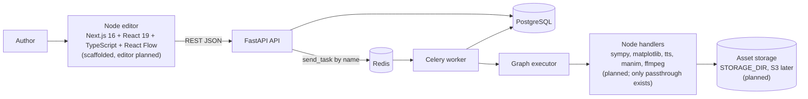
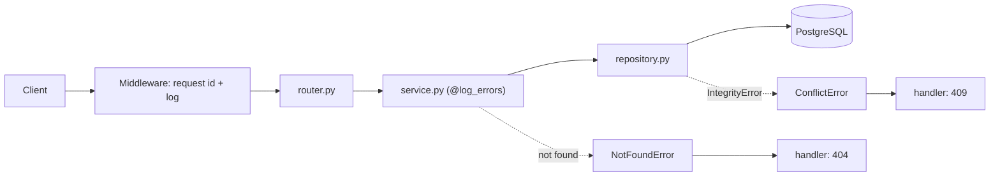
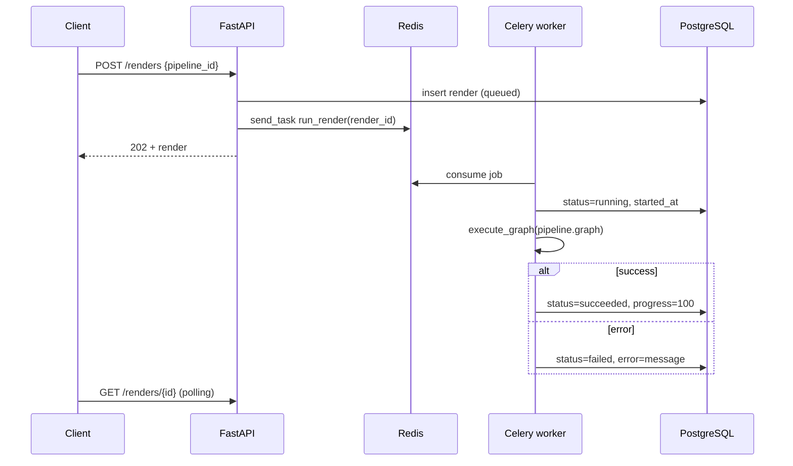
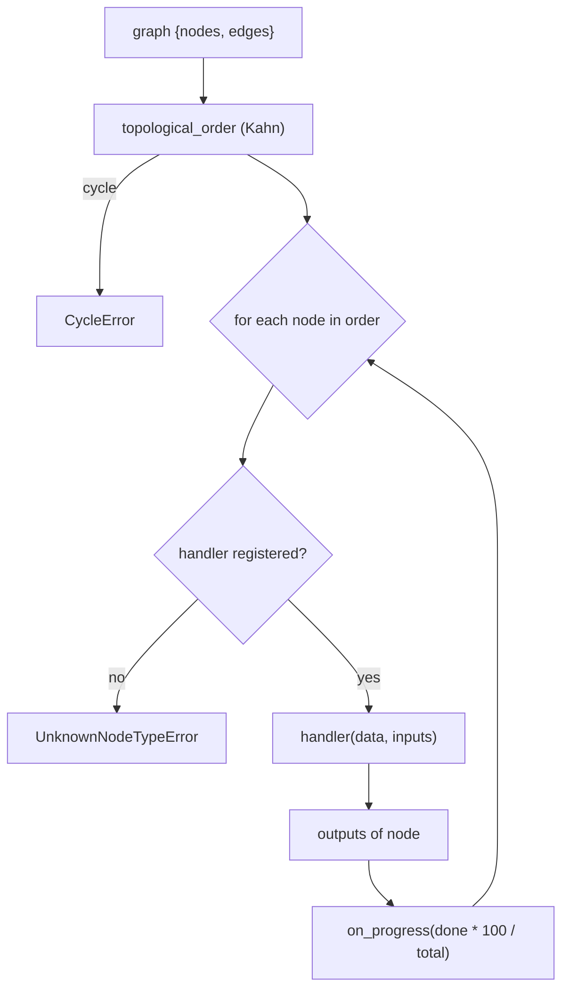

# Architecture

## System context (Implemented backend, Planned frontend)



## Backend layers (Implemented)

Each resource lives in `app/<domain>/` with exactly five files.

| File | Responsibility |
|---|---|
| `router.py` | Thin `APIRouter`; also hosts the domain's own DI provider (e.g. `PipelineServiceDep`) |
| `schemas.py` | Pydantic v2 models: `Create`, `Update` (optional fields), `Read` (`from_attributes`) |
| `models.py` | SQLAlchemy 2.0 ORM (`Mapped[...]`) |
| `service.py` | Business rules, decorated with `@log_errors`; raises domain exceptions |
| `repository.py` | Only place that knows SQLAlchemy; turns `IntegrityError` into `ConflictError` |

Cross-cutting folders:

- `settings/`: `config.py` (pydantic-settings), `logging_config.py`, `middleware.py` (request id, timing, request log).
- `core/`: `dependencies.py` (session, pagination), `decorators.py` (`log_call`, `log_errors`), `exceptions.py` (`NotFoundError`, `ConflictError` with self-registering handlers).
- `db/`: `base.py`, `session.py` (async engine, `get_db_session`), `all_models.py` (imports every model for Alembic).
- `workers/`: queue infrastructure, outside the domain pattern.

Import rule: `core/` never imports from a domain; domain-specific providers stay in that domain's `router.py` to avoid cycles.

## Request flow



`main.py` assembly order: `setup_logging` -> `FastAPI()` -> `register_middleware` ->
`register_exception_handlers` -> one `include_router` per domain. `GET /health` returns `{"status": "ok"}`.

## Render lifecycle (Implemented)



Design notes:

- The API enqueues **by task name** (`dispatch.enqueue_render`), so it never imports task bodies.
- The enqueuer is injected into `RenderService` (`get_render_enqueuer`), so tests run without a broker.
- Each task builds its own engine with `NullPool` because `asyncio.run` creates a new event loop per task.

## Graph executor (Implemented)



- A node's `inputs` is the merge of the outputs of every source node with an edge into it.
- Handlers register with `@node_handler("type")`; signature `handler(data: dict, inputs: dict) -> dict`.
- Only `passthrough` exists today (returns `inputs` merged with `data`). All errors inherit `PipelineError`.

## Repository layout

```
derivaai/
├── docs/                    this folder (English, project-wide)
├── derivaai_frontend/       Next.js 16 app (scaffold only; node editor planned)
└── derivaai_backend/
    ├── app/
    │   ├── main.py
    │   ├── settings/ core/ db/
    │   ├── pipelines/ lessons/ nodes/ renders/ assets/
    │   └── workers/         celery_app, dispatch, executor, tasks
    ├── alembic/             migrations (none generated yet)
    ├── docs/                Portuguese backend docs
    ├── tests/               per-domain tests, executor, decorators
    ├── (no compose: Postgres and Redis come from devbutter_app/infra)
    └── pyproject.toml       Poetry, Python >=3.13
```

## Stack

FastAPI, Pydantic v2, SQLAlchemy 2.0 async, Alembic, PostgreSQL, Celery + Redis, Poetry.
Planned for nodes: SymPy, SciPy, Matplotlib, Manim, FFmpeg, TTS. Frontend (Next.js 16, React 19, TypeScript, Yarn): installed KaTeX, lucide-react, clsx, Sass.

Planned frontend libs:

- `@xyflow/react` (React Flow): node editor, client-only (`"use client"` + `dynamic(..., { ssr: false })`).
- Zustand: editor state.
- TanStack Query: server state and polling of Celery job status.
- `next-intl`: i18n (EN and pt-BR).
- Zod: payload and form validation.
- `openapi-typescript`: TypeScript types generated from the FastAPI OpenAPI schema.
