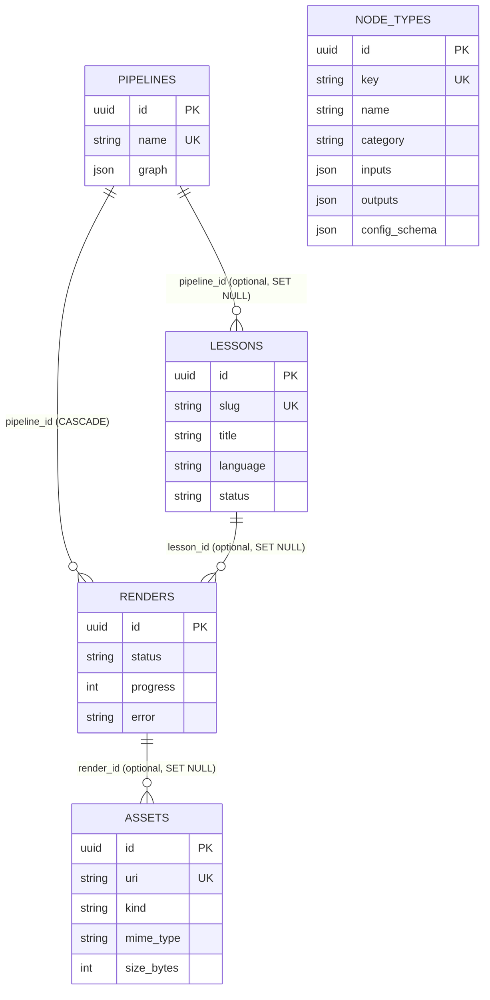
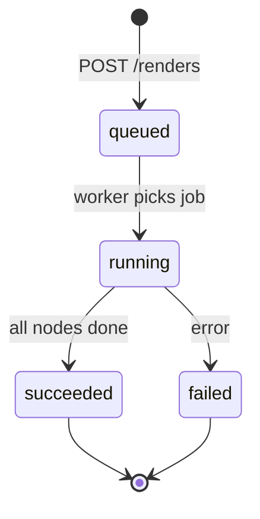

# Data model and API (Implemented)

## ER diagram

`node_types` is an independent catalog: a pipeline graph references types through each node's `type`
field, with no foreign key.

## Conventions

- Lists accept `?offset=0&limit=20` (`offset >= 0`, `1 <= limit <= 100`).
- Errors: `404` missing resource, `409` unique violation, `422` invalid payload.
- Unique columns: `pipelines.name`, `lessons.slug`, `node_types.key`, `assets.uri`. The database constraint
  is the source of truth; the repository maps `IntegrityError` to `ConflictError` (409).
- Every route declares `response_model`, an explicit `status_code` and a `summary`.

## Entities

### pipelines
Free-form React Flow graph. `graph` is `{"nodes": [{"id","type","data"}], "edges": [{"source","target"}]}`.
Fields: `id`, `name` (unique), `description`, `graph`, `created_at`, `updated_at`.
Deleting a pipeline cascades to its renders and sets `lessons.pipeline_id` to null.

### lessons
Narrated lesson; the pipeline is optional.
Fields: `id`, `slug` (unique, `^[a-z0-9]+(-[a-z0-9]+)*$`), `title`, `language` (`pt-BR` | `en`, default `pt-BR`),
`status` (`draft` | `rendering` | `ready` | `failed`, default `draft`), `pipeline_id`, timestamps.

### nodes (node types)
Catalog the editor uses to offer nodes. Execution is done by handlers registered in the worker.
Fields: `id`, `key` (unique, e.g. `sympy.solve`, `^[a-z0-9_]+(\.[a-z0-9_]+)*$`), `name`,
`category` (`math` | `plot` | `animation` | `narration` | `audio` | `video` | `io`), `description`,
`inputs` / `outputs` (lists of `{name, type}`), `config_schema` (JSON), `created_at`.

### renders
One execution of a pipeline, optionally on behalf of a lesson. State changes only through the worker.
Fields: `id`, `pipeline_id` (required), `lesson_id`, `status` (`queued` | `running` | `succeeded` | `failed`),
`progress` (0-100), `error`, `started_at`, `finished_at`, `created_at`.

### assets
Generated or uploaded files (plots, animations, narration audio, final video). Today only metadata is
stored; writing files to storage is roadmap slice 3.
Fields: `id`, `uri` (unique), `kind` (`image` | `audio` | `video` | `data`), `mime_type`, `size_bytes`, `render_id`, `created_at`.

## Endpoints

| Method | Path | Status | Notes |
|---|---|---|---|
| GET | `/health` | 200 | `{"status": "ok"}` |
| POST | `/pipelines/` | 201 | Create a pipeline |
| GET | `/pipelines/` | 200 | List |
| GET | `/pipelines/{pipeline_id}` | 200 | Get |
| PATCH | `/pipelines/{pipeline_id}` | 200 | Partial update |
| DELETE | `/pipelines/{pipeline_id}` | 204 | Cascades to renders |
| POST | `/lessons/` | 201 | Create a lesson |
| GET | `/lessons/` | 200 | List |
| GET | `/lessons/{lesson_id}` | 200 | Get |
| PATCH | `/lessons/{lesson_id}` | 200 | Partial update |
| DELETE | `/lessons/{lesson_id}` | 204 | |
| POST | `/nodes/` | 201 | Register a node type |
| GET | `/nodes/?category=` | 200 | List, filter by category |
| GET | `/nodes/{node_type_id}` | 200 | Get |
| PATCH | `/nodes/{node_type_id}` | 200 | Partial update |
| DELETE | `/nodes/{node_type_id}` | 204 | |
| POST | `/renders/` | 202 | 404 if pipeline missing; stores `queued`, enqueues job |
| GET | `/renders/?status_filter=&pipeline_id=` | 200 | Newest first |
| GET | `/renders/{render_id}` | 200 | Poll status and progress |
| POST | `/assets/` | 201 | Register an asset |
| GET | `/assets/?render_id=` | 200 | List, filter by render |
| GET | `/assets/{asset_id}` | 200 | Get |
| PATCH | `/assets/{asset_id}` | 200 | Partial update |
| DELETE | `/assets/{asset_id}` | 204 | |

`renders` has no `PATCH` or `DELETE`. Interactive docs are served at `/docs` when running locally.
