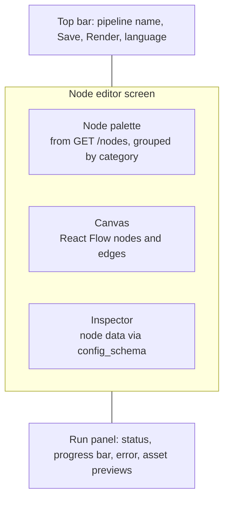
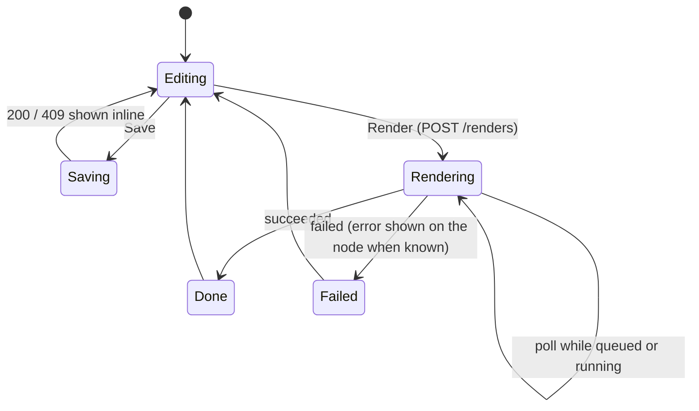

# Design and UI

> **Superseded** by [`../design/`](../design/README.md): design system, layout and wireframes. Kept for history.

Status: **design intent**. `derivaai_frontend/` is empty and there is no logo file in the repository yet.
This document records the decisions made so far so the frontend slice (7) starts from a shared picture.

## Brand mark

- Logo: the **del / partial derivative symbol (∂)**, tying the name to calculus ("deriva" is Portuguese for derivative).
- Languages of the product: English and Brazilian Portuguese.
- No palette, typography or exported asset has been fixed yet; add them here once chosen.

## Product principle

Pipelines are free-form. The "lesson workflow" (script -> narration -> animation -> video) is an optional
template, never a constraint. The editor must allow any valid DAG of catalog nodes.

## Editor layout (planned, React Flow)

| Area | Backed by | Behavior |
|---|---|---|
| Palette | `GET /nodes/?category=` | Drag a node type onto the canvas; categories `math`, `plot`, `animation`, `narration`, `audio`, `video`, `io` |
| Canvas | `pipelines.graph` | Nodes `{id, type, data}` and edges `{source, target}`, saved as-is (React Flow format) |
| Inspector | `node_types.config_schema` | Form generated from the JSON schema; writes into the node's `data` |
| Top bar | `PATCH /pipelines/{id}` | Save; names are unique, a clash returns 409 and should surface inline |
| Run panel | `POST /renders/`, `GET /renders/{id}`, `GET /assets/?render_id=` | 202 then polling; show `progress`, `error`, then image/audio/video assets |

## Editor interaction flow

## Frontend stack (proposed)

React, TypeScript, React Flow. Typed API client generated from the FastAPI OpenAPI schema is the natural
fit, since every route already declares `response_model`.

## Not decided yet

Visual identity (colors, type, logo file), dark/light theme, node visuals per category, lesson library screen,
authentication (out of MVP).
