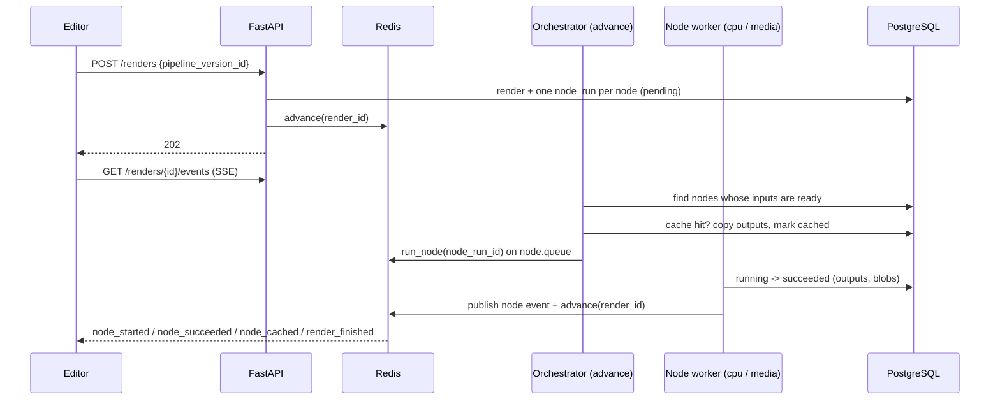
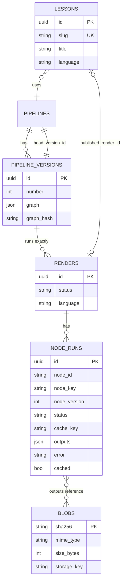

# Design v2 (proposal)

Status: **proposal, not implemented**. It replaces parts of the current prototype described in
[architecture.md](architecture.md) and [data-model-and-api.md](data-model-and-api.md). Nothing in the code
has changed yet. Since there is no production data, now is the cheapest moment to change the model.

## Why change the prototype

The prototype is a clean CRUD skeleton, but it models DerivaAI as "five tables with REST endpoints". The
product is a **node-graph execution engine** (ComfyUI-style) whose output is a lesson video. Six problems follow:

| # | Problem in the prototype | Consequence |
|---|---|---|
| 1 | Edges are `{source, target}` and a node's input is the **dict merge** of upstream outputs | Two upstream nodes with an output of the same name silently overwrite each other; no typed ports, so the editor cannot tell what connects to what |
| 2 | A render points to a **mutable** pipeline | Editing a pipeline while it renders changes the result; old renders are not reproducible |
| 3 | One `progress` number per render; no per-node state | The editor cannot show which node failed, preview intermediate output, or skip nodes that did not change. Every render recomputes Manim and TTS from scratch: slow and expensive |
| 4 | Node catalog lives in a DB table **and** handlers live in code | Two sources of truth that drift: a catalog entry with no handler fails only at run time |
| 5 | `assets` is client-editable CRUD with a unique `uri`; node outputs travel as in-memory dicts | Clients can register fake files; audio/video/arrays have no proper home between nodes |
| 6 | `lesson.status` duplicates render status; polling only | State can disagree; the editor has to poll every few seconds |

## Core ideas

1. **Typed ports.** Nodes declare named, typed inputs and outputs; edges connect a specific output port to a specific input port.
2. **Nodes are defined in code.** One Python class per node type holds its config, ports and `run`. The catalog API is generated from it.
3. **Immutable pipeline versions.** Saving creates a version; a render runs one exact version.
4. **Per-node runs with content-addressed caching.** Each node execution is a row; identical inputs reuse previous output.
5. **Blobs, not paths.** Every file is stored once, keyed by its SHA-256; nodes exchange small JSON values or blob references.
6. **Push events.** The worker publishes per-node events; the editor subscribes over SSE.

## Graph spec v2

```json
{
  "nodes": [
    {"id": "params", "type": "io.params", "version": 1, "config": {"R": 1000, "C": 0.001, "V0": 5}},
    {"id": "solve", "type": "math.solve_ode", "version": 1, "config": {"equation": "R*C*Derivative(V(t), t) + V(t) - V0"}},
    {"id": "plot", "type": "plot.function", "version": 1, "config": {"t_max_in_tau": 5}}
  ],
  "edges": [
    {"from": {"node": "params", "port": "values"}, "to": {"node": "solve", "port": "params"}},
    {"from": {"node": "solve", "port": "solution"}, "to": {"node": "plot", "port": "fn"}}
  ],
  "ui": {"params": {"x": 0, "y": 0}, "solve": {"x": 260, "y": 0}}
}
```

- `ui` holds canvas positions so layout changes do not affect execution or caching.
- React Flow maps directly: `sourceHandle` / `targetHandle` are the port names.
- An input port accepts **one** edge (unless the port is declared `list`), so there is never an implicit merge.

### Port types

| Type | Value travels as | Example |
|---|---|---|
| `number`, `text`, `bool` | JSON | `V0`, narration script |
| `params` | JSON object | `{R, C, V0}` |
| `expr` | SymPy string (`srepr`) | `V0*(1 - exp(-t/(R*C)))` |
| `series` | blob ref (Parquet/NPY) | sampled `V(t)` |
| `image`, `audio`, `video` | blob ref | plot PNG, narration WAV, scene MP4 |

The validator rejects an edge whose port types do not match (with explicit coercions only, e.g. `number` -> `text`).

## Nodes as code

```python
# app/nodes/library/math.py
@register_node
class SolveODE(NodeDef):
    key = "math.solve_ode"
    version = 1                    # bump when behavior changes -> invalidates cache
    category = "math"
    queue = "cpu"                  # "cpu" or "media" (Manim/FFmpeg image)

    class Config(BaseModel):
        equation: str
        function: str = "V(t)"

    class Inputs(BaseModel):
        params: Params

    class Outputs(BaseModel):
        solution: Expr

    def run(self, config: Config, inputs: Inputs, ctx: RunContext) -> Outputs: ...
```

- `GET /nodes` returns every registered class: key, version, category, port types and the JSON Schema of `Config` (from Pydantic). The editor's inspector form comes straight from it.
- No `node_types` table and no `POST /nodes`: adding a node is a code change with a test.
- `RunContext` gives the node `language`, a blob store, a logger and `report_progress(0..1)`.

## Execution model



- **`advance(render_id)`** is small and idempotent: it locks the render row, schedules every node whose upstream runs have all succeeded, and finishes the render when nothing is left. Independent branches (TTS and Manim in the RC lesson) run in parallel.
- **Queues by node.** `cpu` for SymPy, Matplotlib and TTS calls; `media` for Manim and FFmpeg in their own Docker image. The API never needs those native dependencies.
- **Cache key** = `sha256(node.key, node.version, canonical(config), hashes of input values)`. A previous succeeded `node_run` with the same key is reused. Editing only the narration text re-runs TTS and the final compose, not SymPy, the plot or Manim.
- **Failure** stops downstream nodes (`skipped`); sibling branches finish. The error lands on the failing `node_run`, so the editor highlights that node.
- **Cancel**: `POST /renders/{id}/cancel` marks pending runs `canceled`; running ones finish and are discarded.

## Data model v2



| Table | Change from prototype |
|---|---|
| `pipelines` | Keeps `name` (unique) and `description`; `graph` moves to versions; adds `head_version_id` |
| `pipeline_versions` | **New.** Immutable `graph` + `graph_hash`; `number` increments per pipeline. Saving an identical graph does not create a version |
| `renders` | Points to `pipeline_version_id`; adds `language`, `canceled` status; `progress` becomes derived (done / total node_runs) |
| `node_runs` | **New.** One per node per render; status `pending`, `running`, `succeeded`, `cached`, `failed`, `skipped`, `canceled`; index on `cache_key` |
| `blobs` | **New**, replaces `assets`. Content-addressed; `storage_key` points to local disk now, S3 later, behind one `BlobStore` interface |
| `lessons` | Drops `status`; adds `published_render_id`. Shown status is derived: draft (no render), rendering, ready (published render succeeded) |
| `node_types` | **Removed** (catalog comes from code) |
| `assets` | **Removed** (outputs are `node_runs.outputs` pointing to `blobs`) |

## API v2

| Method | Path | Notes |
|---|---|---|
| GET | `/nodes` | Read-only catalog from code (key, version, category, ports, config schema) |
| POST | `/pipelines/validate` | Validate a graph without saving: cycles, unknown types, port type mismatch, missing required inputs, config errors. Returns errors keyed by node/edge for the editor |
| POST / GET / PATCH / DELETE | `/pipelines...` | Pipeline metadata |
| POST | `/pipelines/{id}/versions` | Save a graph (validated); returns the version (201) or the existing one if the hash matches (200) |
| GET | `/pipelines/{id}/versions[/{n}]` | History and a given version |
| POST | `/renders` | `{pipeline_version_id, language, lesson_id?}` -> 202 |
| GET | `/renders/{id}` | Render with its node runs |
| GET | `/renders/{id}/events` | **SSE** stream of node and render events |
| POST | `/renders/{id}/cancel` | Cancel |
| POST | `/blobs` | Upload a user file (multipart); returns `sha256` (deduplicated) |
| GET | `/blobs/{sha256}` | Download / stream (range requests for video) |
| CRUD | `/lessons...` | Plus `POST /lessons/{id}/publish {render_id}` |

## Editor implications

- Ports are colored by type; dragging an edge highlights only compatible ports. Validation runs on every change via `/pipelines/validate` (debounced).
- Each node shows a live badge (pending, running with progress, cached, failed) from SSE, and an inline preview of its output: the formula, the plot, an audio player, a video.
- "Run" saves a version if the graph changed and renders it; because of caching, small edits re-render in seconds.
- A failed node opens the inspector with the error; downstream nodes show as skipped.
- History panel lists versions and their renders; any old render stays reproducible.

## What stays

fastapibuilder pattern (five files per domain), Python 3.13+, FastAPI + Pydantic v2 + SQLAlchemy async,
PostgreSQL, Celery + Redis, the 409 translation, the decorators and exception registry, the topological
algorithm (reused by the validator and by `advance`), the RC circuit as acceptance lesson.

Domain packages after v2: `pipelines` (pipelines + versions), `renders` (renders + node runs + events),
`blobs`, `lessons`, `nodes` (its `repository.py` reads the in-code registry instead of the database, so the
five-file shape is kept). `app/nodes/library/` holds node classes; `app/workers/` holds `advance`, `run_node`
and the cache lookup.

## Revised roadmap

| # | Slice | Done when |
|---|---|---|
| 1 | **Foundation + model v2**: replace tables (versions, node_runs, blobs; drop node_types and assets), initial migration, Postgres/Redis up | Tests green; `/pipelines/validate` rejects a cycle and a port mismatch |
| 2 | **Execution v2**: node classes, `advance`, `run_node`, cache, SSE events; nodes `io.params`, `math.solve_ode`, `plot.function` | RC chart rendered; a second render of the same version is fully `cached` |
| 3 | **Blobs**: `BlobStore` on local disk, `POST/GET /blobs` | The plot PNG downloads through `/blobs/{sha256}` |
| 4 | **Narration**: `io.text`, `tts.narrate` (pt-BR, en) | Changing only the script re-runs only TTS and later nodes |
| 5 | **Media worker**: `media` image with Manim and FFmpeg; `anim.rc_charging`, `video.compose` | Final MP4 as a blob |
| 6 | **Lesson end to end**: RC template, `publish` | Lesson shows ready with the published video |
| 7 | **Editor**: React Flow with typed ports, live validation, SSE badges, previews | RC lesson rebuilt and re-rendered from the UI |

## Decisions this proposal needs

1. Approve the model change before slice 1 (it breaks the current endpoints `/nodes` CRUD and `/assets`).
2. Execution start: event-driven `advance` from slice 2 (recommended), or one task per render first and split later.
3. Still open from before: TTS provider for pt-BR; local disk vs S3 (the `BlobStore` interface makes this a config switch).
