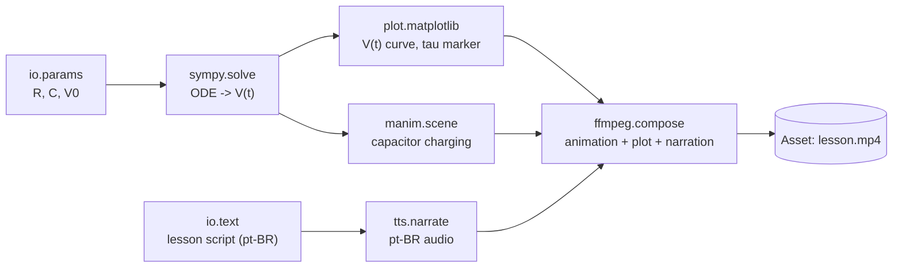
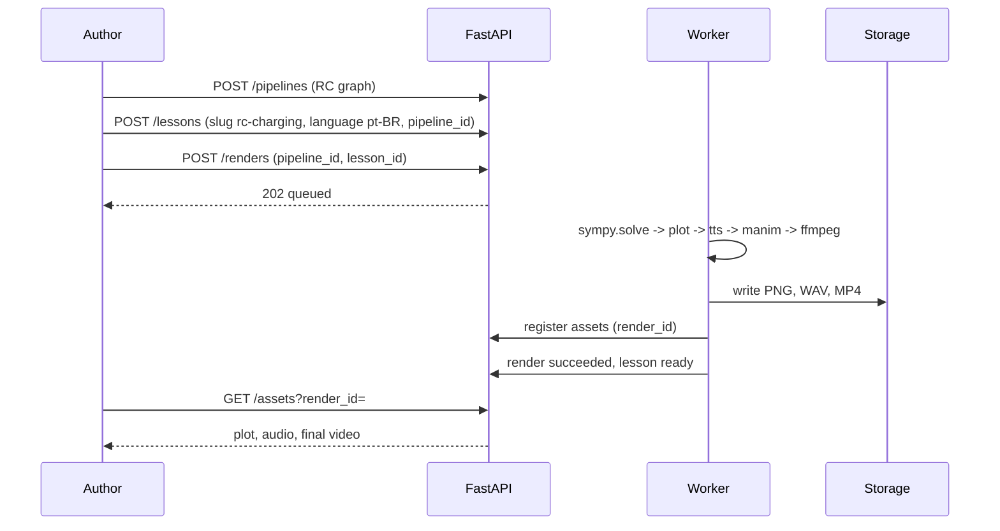

# Acceptance lesson: RC circuit charging

The first end-to-end target for the MVP: a pt-BR lesson on the charging of a capacitor through a resistor,
delivered as a narrated MP4. Today only the executor and the `passthrough` handler exist; every node
below except `passthrough` is **Planned** (roadmap slices 2 to 6).

## Physics being taught

Series RC circuit driven by a DC source V0, capacitor initially discharged.

- ODE: `RC dV/dt + V = V0`
- Solution: `V(t) = V0 (1 - e^(-t/RC))`
- Time constant: `tau = RC`; at `t = tau` the capacitor reaches about 63.2% of V0.

## Pipeline graph



Node keys follow the catalog pattern `^[a-z0-9_]+(\.[a-z0-9_]+)*$`. `io.params` and `io.text` are
illustrative names for input nodes in the `io` category; the final keys are decided when slice 2 lands.

## Stored graph shape

```json
{
  "nodes": [
    {"id": "n1", "type": "io.params", "data": {"R": 1000, "C": 0.001, "V0": 5}},
    {"id": "n2", "type": "sympy.solve", "data": {"equation": "R*C*Derivative(V(t), t) + V(t) - V0"}},
    {"id": "n3", "type": "plot.matplotlib", "data": {"t_max_in_tau": 5}}
  ],
  "edges": [
    {"source": "n1", "target": "n2"},
    {"source": "n2", "target": "n3"}
  ]
}
```

This is the slice-2 subset (two computing nodes). The executor already handles this shape; ordering is
topological and each node receives the merged outputs of its predecessors.

## End-to-end sequence



## Slice map

| Slice | Delivers | Visible result |
|---|---|---|
| 1 Foundation | Real Postgres/Redis, initial migration, API + worker up | `passthrough` render reaches `succeeded` |
| 2 Math and plot | `sympy.solve`, `plot.matplotlib` | RC charging chart |
| 3 Real assets | Context (`STORAGE_DIR`) passed to handlers, one `Asset` per output | `GET /assets?render_id=` lists the PNG |
| 4 Narration | `tts.narrate` in pt-BR and en | Narration audio asset |
| 5 Animation and video | `manim.scene`, `ffmpeg.compose` | Final MP4 asset |
| 6 End to end | RC template pipeline, lesson goes to `ready` | One `POST` yields the video |
| 7 Editor | React Flow UI | Rebuild the RC lesson without calling the API by hand |

## Open questions that affect this flow

1. TTS provider with good pt-BR quality (slice 4).
2. Local disk versus S3 for assets (slice 3).
3. Manim and FFmpeg in the same worker or in a separate image with native dependencies.
